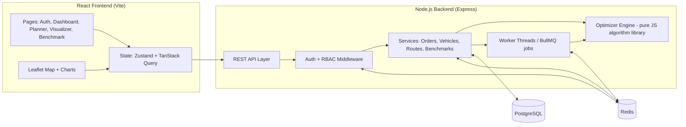
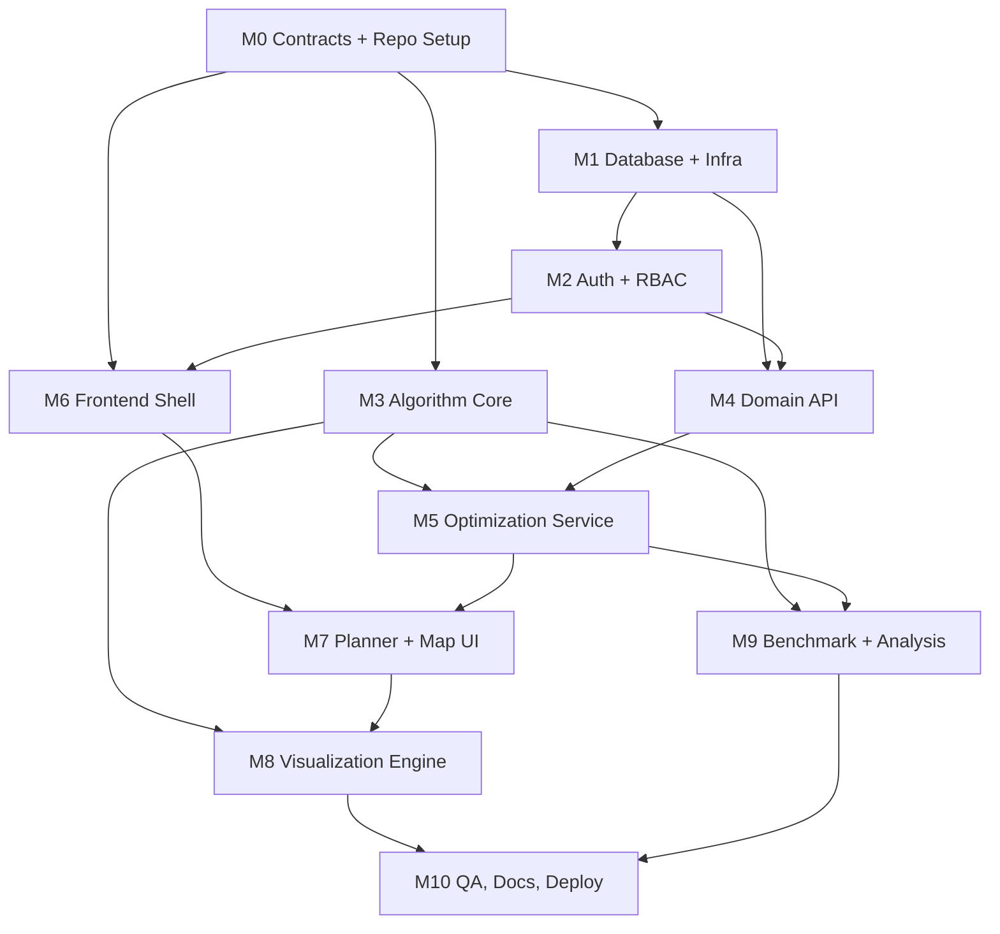

# Courier Delivery Route Optimizer — plan.md

> Subject: Design and Analysis of Algorithms (DAA)
> Stack: React JS · Node.js (Express) · PostgreSQL · Redis · JWT Auth
> Core idea: all routing algorithms are **implemented from scratch** (no routing library does the optimization). The web app exists to run them on real data, visualize them step by step, and benchmark their complexity.

---

## 1. Problem Statement

A courier company has a **depot**, several **vehicles** (each with a capacity), and many **delivery stops** (each with a location, package weight, and optional time window). Goal: assign stops to vehicles and decide the visiting order so that **total distance (or time) is minimized**, while respecting capacity and time windows.

Formally this is the **Capacitated Vehicle Routing Problem with Time Windows (CVRPTW)**, a generalization of the **Travelling Salesman Problem (TSP)**. Both are **NP-hard**, which is what makes it a good DAA project: we compare exact algorithms (optimal but exponential) against greedy, heuristic, and approximation algorithms (fast but approximate), and measure the trade-off.

### Problem levels (built incrementally)

| Level | Problem | Algorithms used |
|---|---|---|
| L1 | Shortest path between two points on a road graph | Dijkstra, A*, Bellman-Ford |
| L2 | All-pairs distances for stops | Floyd–Warshall, repeated Dijkstra |
| L3 | Single vehicle, visit all stops (TSP) | Brute force, Held–Karp DP, Nearest Neighbor, MST 2-approx, 2-opt, Simulated Annealing |
| L4 | Multiple vehicles + capacity (CVRP) | Clustering (Sweep / K-means) + TSP per cluster, Clarke–Wright Savings |
| L5 | Time windows | Greedy scheduling + feasibility check inside local search |

---

## 2. DAA Concepts Covered (for report and viva)

| Technique | Where it appears |
|---|---|
| Greedy | Nearest Neighbor, Clarke–Wright Savings, Kruskal MST, Dijkstra, activity-style time-window ordering |
| Dynamic Programming | Held–Karp (bitmask DP), Floyd–Warshall, 0/1 Knapsack for vehicle load packing |
| Divide and Conquer | Merge sort for sorting savings/stops, closest-pair style geographic clustering (optional) |
| Backtracking / Branch and Bound | Exact TSP for small n with pruning (lower bound via MST/min edges) |
| Graph algorithms | Dijkstra, A*, Bellman-Ford, Floyd–Warshall, Prim/Kruskal MST |
| Approximation | MST-based 2-approximation for metric TSP |
| Local search / Metaheuristics | 2-opt, Or-opt, Simulated Annealing |
| Complexity analysis | Empirical benchmark vs theoretical O(·) curves, optimality gap |
| NP-hardness | Reduction discussion: TSP ≤ VRP, why exact fails beyond ~20 stops |

### Data structures to implement manually

| Data structure | Used for |
|---|---|
| Binary Min-Heap / Priority Queue | Dijkstra, A*, Prim, savings list |
| Adjacency List + Adjacency Matrix | Road graph, distance matrix |
| Disjoint Set Union (Union-Find) with path compression and union by rank | Kruskal MST, Clarke–Wright route merging |
| Hash Map / Set | Visited tracking, stop lookup, memoization |
| Bitmask + 2D DP table | Held–Karp |
| Doubly Linked List / Array of routes | 2-opt, Or-opt segment moves |
| LRU Cache (optional, in-memory layer) | Local distance cache before Redis |
| Queue / Stack | BFS for connectivity checks, DFS for MST preorder walk |

---

## 3. System Architecture

### 3.1 High-level diagram



### 3.2 Layered view

```
┌──────────────────────────────────────────────────────────────┐
│ PRESENTATION   React + Leaflet + Recharts + D3 (visual layer)│
├──────────────────────────────────────────────────────────────┤
│ API            Express routes, validation (zod), RBAC        │
├──────────────────────────────────────────────────────────────┤
│ SERVICE        Business logic, job orchestration, caching    │
├──────────────────────────────────────────────────────────────┤
│ ALGORITHM CORE Pure functions, zero I/O, fully unit-tested   │
│                (graph, heap, DSU, TSP, VRP, local search)    │
├──────────────────────────────────────────────────────────────┤
│ DATA           PostgreSQL (persistent) · Redis (cache/queue) │
└──────────────────────────────────────────────────────────────┘
```

**Key design rule:** the Algorithm Core never imports Express, Postgres, or Redis. It takes plain data in and returns plain data out. This makes it testable, benchmarkable, and safe for multiple agents to work on independently.

### 3.3 Request flow: "Optimize routes"

1. Dispatcher selects stops + vehicles + algorithm on the Planner page, clicks **Optimize**.
2. `POST /api/optimizations` (JWT required, role dispatcher/admin).
3. Service builds an input hash. **Redis lookup**: if the same input + algorithm was solved before, return the cached result immediately.
4. Otherwise build the distance matrix (Haversine, or Dijkstra over road graph). Matrix is cached in Redis.
5. Job is pushed to a worker (worker_threads for small, BullMQ for long jobs). Response returns `jobId`.
6. Worker runs the chosen algorithm, records runtime, operation counts, and optional step trace.
7. Result stored in PostgreSQL (`optimization_runs`, `routes`, `route_stops`) and in Redis.
8. Frontend polls (or uses SSE) for status, then draws routes and metrics.

### 3.4 Distance model

- **Default:** Haversine great-circle distance between coordinates (fast, deterministic, no external API).
- **Road graph mode:** a generated or imported graph (nodes = intersections, edges = roads with weights). Dijkstra/A* computes real shortest paths between stops, then feeds the TSP/VRP layer.
- **Demo mode:** a synthetic grid city generator with random blocked/slow edges, which makes Dijkstra vs A* visually clear.

---

## 4. Tech Stack and Libraries

### Frontend (React JS)

| Purpose | Library |
|---|---|
| Build tool | Vite |
| UI framework | React 18 + React Router v6 |
| Styling | Tailwind CSS (or MUI) |
| Server state | TanStack Query |
| Client state | Zustand |
| HTTP | Axios |
| Forms + validation | React Hook Form + zod |
| Map | Leaflet + react-leaflet (OpenStreetMap tiles, no API key) |
| Charts | Recharts (benchmarks, convergence) |
| Algorithm animation | D3.js (graph/DP-table rendering) + `requestAnimationFrame` playback engine |
| Notifications | react-hot-toast |
| Testing | Vitest + React Testing Library |

### Backend (Node.js)

| Purpose | Library |
|---|---|
| Server | Express |
| DB access | `pg` + Prisma or Knex (pick one, see Module 1) |
| Cache / queue | `ioredis`, BullMQ |
| Auth | `jsonwebtoken`, `bcrypt`, `cookie-parser` |
| Validation | zod |
| Security | helmet, cors, express-rate-limit |
| Parallel compute | Node `worker_threads` |
| Logging | pino |
| API docs | swagger-ui-express (OpenAPI) |
| Testing | Jest/Vitest + Supertest |

### Infra

- Docker Compose: `postgres`, `redis`, `api`, `web`
- ESLint + Prettier, Husky pre-commit
- GitHub Actions: lint + test on push

---

## 5. Database Design (PostgreSQL)

```
users(id, name, email UNIQUE, password_hash, role ENUM[admin,dispatcher,driver], created_at)
depots(id, owner_id→users, name, lat, lng)
vehicles(id, owner_id→users, depot_id→depots, name, capacity, driver_id→users NULL)
stops(id, owner_id→users, label, address, lat, lng, demand, tw_start, tw_end, service_time)
optimization_runs(id, owner_id, algorithm, params JSONB, input_hash, total_distance,
                  runtime_ms, op_count, status, created_at)
routes(id, run_id→optimization_runs, vehicle_id→vehicles, distance, load)
route_stops(id, route_id→routes, stop_id→stops, seq, arrival_time)
benchmark_results(id, run_batch, algorithm, n_stops, runtime_ms, cost, optimal_cost NULL, gap_pct)
refresh_tokens(id, user_id, token_hash, expires_at, revoked)
```

Indexes: `stops(owner_id)`, `optimization_runs(owner_id, created_at DESC)`, `optimization_runs(input_hash)`, `route_stops(route_id, seq)`.

### Redis usage

| Key pattern | Purpose | TTL |
|---|---|---|
| `dist:{matrixHash}` | Cached distance matrix | 1 h |
| `opt:{inputHash}:{algo}` | Cached optimization result | 1 h |
| `rl:{ip}:{route}` | Rate limiting counters | window |
| `bl:{jti}` | Revoked JWT ids (logout) | token lifetime |
| BullMQ keys | Job queue + progress | managed |

---

## 6. Authentication and Authorization

**Signup / Login**
- `POST /api/auth/signup` — validate with zod, hash password with bcrypt (cost 12), create user (default role `dispatcher`).
- `POST /api/auth/login` — verify, issue **access token** (JWT, 15 min, in memory on client) and **refresh token** (7 days, httpOnly + Secure + SameSite cookie, hash stored in DB, rotated on use).
- `POST /api/auth/refresh`, `POST /api/auth/logout` (revoke refresh token + blacklist access `jti` in Redis), `GET /api/auth/me`.

**RBAC**

| Role | Permissions |
|---|---|
| admin | Everything, manage users, view all runs, run benchmarks |
| dispatcher | CRUD own stops/vehicles/depots, run optimizations, view own runs |
| driver | Read-only view of own assigned route and stop sequence |

Middleware: `authenticate` (verify JWT, check Redis blacklist) → `authorize(...roles)` → `ownsResource` check.

Protections: rate limit on login (5/min/IP), generic error messages, helmet headers, input validation on all routes, parameterized queries only.

---

## 7. API Design (summary)

| Method | Endpoint | Role | Description |
|---|---|---|---|
| POST | /api/auth/signup, /login, /refresh, /logout | public/auth | Auth lifecycle |
| GET/POST/PUT/DELETE | /api/stops | dispatcher, admin | Manage stops |
| GET/POST/PUT/DELETE | /api/vehicles, /api/depots | dispatcher, admin | Fleet and depots |
| POST | /api/stops/import | dispatcher | CSV bulk import |
| POST | /api/optimizations | dispatcher, admin | Start optimization (returns jobId) |
| GET | /api/optimizations/:id | owner/admin | Status + result |
| GET | /api/optimizations/:id/trace | owner/admin | Step trace for animation |
| POST | /api/compare | dispatcher, admin | Run several algorithms on same input |
| POST | /api/benchmarks | admin | Run scaling benchmark (n = 5…N) |
| GET | /api/benchmarks | admin | Past benchmark results |
| GET | /api/driver/route | driver | Assigned route |
| POST | /api/generate/instance | dispatcher | Generate random test instance |

**Algorithm contract** (shared by all solvers, the heart of collaboration):

```js
// input
{ matrix: number[][],        // n x n distances, index 0 = depot
  demands: number[],         // demands[0] = 0
  capacity: number,          // per vehicle
  vehicles: number,
  timeWindows?: [start,end][],
  serviceTimes?: number[],
  options?: { seed, maxIterations, trace: boolean } }

// output
{ routes: number[][],        // each route = [0, ...stopIdx, 0]
  totalCost: number,
  perRouteCost: number[],
  stats: { runtimeMs, operations, iterations },
  trace?: TraceStep[] }      // for visualization
```

**TraceStep format** (so the visualizer needs no algorithm-specific code):
```js
{ type: 'visit'|'relax'|'swap'|'accept'|'reject'|'merge'|'dp-cell'|'cluster',
  data: {...}, cost?: number, note: string }   // note = human-readable explanation
```

---

## 8. Algorithm Specifications

| # | Algorithm | Problem | Time | Space | Exact? |
|---|---|---|---|---|---|
| A1 | Dijkstra (binary heap) | Shortest path | O((V+E) log V) | O(V) | Yes |
| A2 | A* (Euclid/Haversine heuristic) | Shortest path | O(E) typical, worst exponential | O(V) | Yes (admissible h) |
| A3 | Bellman-Ford | Shortest path (negative edges, comparison) | O(VE) | O(V) | Yes |
| A4 | Floyd–Warshall | All-pairs | O(V³) | O(V²) | Yes |
| A5 | Brute force TSP (backtracking) | TSP, n ≤ 10 | O(n!) | O(n) | Yes |
| A6 | Branch and Bound TSP | TSP, n ≤ 15 | exponential, pruned | O(n) | Yes |
| A7 | Held–Karp DP | TSP, n ≤ 18–20 | O(n² 2ⁿ) | O(n 2ⁿ) | Yes |
| A8 | Nearest Neighbor | TSP/VRP seed | O(n²) | O(n) | No |
| A9 | MST 2-approximation (Prim/Kruskal + DFS preorder) | Metric TSP | O(n² ) / O(E log E) | O(n) | 2-approx |
| A10 | 2-opt | Improve a tour | O(n²) per pass | O(n) | No (local opt) |
| A11 | Or-opt | Improve a tour | O(n²) per pass | O(n) | No |
| A12 | Simulated Annealing | TSP/VRP | O(iterations) | O(n) | No |
| A13 | Sweep + per-cluster TSP | CVRP | O(n log n) + TSP | O(n) | No |
| A14 | K-means clustering + TSP | CVRP | O(k n t) | O(n) | No |
| A15 | Clarke–Wright Savings | CVRP | O(n² log n) | O(n²) | No |
| A16 | Time-window feasibility check (greedy insertion) | CVRPTW | O(n) per check | O(1) | — |

**Recommended pipeline for large instances:** Savings (A15) or Sweep (A13) → 2-opt/Or-opt (A10/A11) → Simulated Annealing polish (A12), with time-window feasibility enforced on every move.

**Exact baseline** (A7) provides optimal cost for small n so every heuristic reports an **optimality gap**: `gap% = (heuristic − optimal) / optimal × 100`.

---

## 9. Visualization Plan

Goal: someone who has never seen the algorithm should understand what it is doing and why it is fast or slow.

### 9.1 Map views (Leaflet)
- Depot (square marker), stops (numbered circles colored by vehicle), routes as polylines with direction arrows.
- Hover a stop to see demand, time window, arrival time.
- Toggle per-vehicle layers; side panel shows distance, load/capacity bar, and ordered stop list.
- Time-window violations highlighted in red.

### 9.2 Algorithm step-through player
A shared playback engine (play/pause/step/speed slider/scrub bar) that consumes `TraceStep[]` from any algorithm:

| Algorithm | What the user sees |
|---|---|
| Dijkstra / A* | Graph with frontier nodes expanding as a colored wave; priority queue contents shown beside it; A* vs Dijkstra explored-node count compared side by side |
| Held–Karp | DP table (subset × last city) as a heatmap filling in; current subset highlighted in bitmask form |
| Nearest Neighbor | Tour growing one edge at a time, candidate edges shown dashed |
| MST 2-approx | MST drawn first, then DFS walk, then shortcut tour |
| 2-opt / Or-opt | Two edges highlighted, swap animated, cost delta shown (green improve / red worse) |
| Simulated Annealing | Live tour + cost-vs-iteration chart + temperature curve; accepted vs rejected moves counter |
| Clarke–Wright | Savings list sorted, routes merging step by step (DSU components shown) |
| Sweep / K-means | Rotating sweep line or moving centroids forming clusters |

Every step shows a one-line plain-English **explanation** (the `note` field), plus a pseudocode panel with the current line highlighted.

### 9.3 Comparison dashboard
- Same instance, multiple algorithms: cost bar chart, runtime bar chart, optimality gap, side-by-side map thumbnails.
- Ranking table with columns: algorithm, cost, runtime, ops, gap %.

### 9.4 Complexity analysis charts (Benchmark page)
- Runtime vs n (log-log) with theoretical curves overlaid (n!, 2ⁿ, n², n log n) to show empirical growth matches theory.
- Cost quality vs n (gap against best known).
- "Where exact algorithms die": marks the n at which Held–Karp exceeds a time limit.
- Exportable CSV/PNG for the project report.

### 9.5 Explainer panel
Each algorithm has a card: idea in 2 lines, pseudocode, time/space complexity, paradigm tag (Greedy/DP/…), when to use it, and limitations.

---

## 10. Module Breakdown (for agent collaboration)

Each module has a **single owner agent**, a clear **input/output contract**, and **acceptance criteria**. Modules communicate only through the contracts in Section 7 and the shared `packages/contracts` folder. Modules marked ∥ can be built in parallel once Module 0 is done.

### Dependency graph



---

### M0 — Contracts and Repo Setup (do first, blocks everyone)
**Owner:** Architect agent
**Tasks**
- Initialize monorepo (npm workspaces): `apps/web`, `apps/api`, `packages/algorithms`, `packages/contracts`.
- Write `packages/contracts`: zod schemas + JSDoc/TS types for solver input/output, TraceStep, API request/response shapes.
- Write OpenAPI skeleton, `.env.example`, ESLint/Prettier, Docker Compose skeleton.
- Write `CONTRIBUTING.md` with the collaboration rules in Section 12.

**Done when:** all other agents can import contracts and run `npm run dev` for an empty app.

---

### M1 — Database and Infrastructure ∥
**Owner:** Data agent
**Tasks**: PostgreSQL schema + migrations (Prisma or Knex), seed script (admin user, sample depot, 30 stops), Redis connection module, Docker Compose for Postgres + Redis, health-check endpoint.
**Output:** `apps/api/src/db`, `apps/api/src/cache`, migrations, seed data.
**Done when:** `docker compose up` gives a migrated, seeded DB and working Redis ping.

---

### M2 — Authentication and Authorization
**Owner:** Security agent (needs M1)
**Tasks**: signup/login/refresh/logout, bcrypt, JWT access + rotating refresh cookie, Redis blacklist, `authenticate`, `authorize(roles)`, `ownsResource`, rate limiting, helmet/cors config.
**Done when:** Supertest suite covers: weak password rejected, duplicate email rejected, wrong password generic error, expired token refresh works, logout invalidates token, driver blocked from optimization endpoints.

---

### M3 — Algorithm Core (heart of the DAA grade) ∥
**Owner:** Algorithms agent(s) — can split into 3 sub-agents
**Folder:** `packages/algorithms/src`
```
ds/         MinHeap.js, UnionFind.js, LRUCache.js, Graph.js
shortest/   dijkstra.js, astar.js, bellmanFord.js, floydWarshall.js
tsp/        bruteForce.js, branchBound.js, heldKarp.js, nearestNeighbor.js, mst2approx.js
improve/    twoOpt.js, orOpt.js, simulatedAnnealing.js
vrp/        sweep.js, kmeansCluster.js, clarkeWright.js, timeWindows.js
util/       haversine.js, distanceMatrix.js, instanceGenerator.js, seededRandom.js, opCounter.js
index.js    registry: { name → { solve, meta: {complexity, paradigm, exact, maxN} } }
```
**Rules**
- Pure functions, no I/O, deterministic with a seed.
- Every solver follows the contract in Section 7 and optionally emits `trace`.
- An `opCounter` records comparisons/relaxations so complexity is measurable independent of machine speed.
- Each file starts with a comment block: idea, paradigm, recurrence/invariant, complexity proof sketch.

**Done when:** each algorithm has unit tests with known answers (e.g. 5-city instance with proven optimal tour), Held–Karp matches brute force for n ≤ 9, Dijkstra matches Bellman-Ford on random graphs, and every VRP result is checked by a validator (capacity, all stops visited exactly once, time windows).

---

### M4 — Domain API ∥ (after M1, M2)
**Owner:** Backend agent
**Tasks**: CRUD for depots, vehicles, stops with zod validation and ownership checks; CSV import; random instance generator endpoint; pagination.
**Done when:** OpenAPI doc matches behavior; integration tests pass.

---

### M5 — Optimization Service (after M3, M4)
**Owner:** Backend agent
**Tasks**: build distance matrix (cache in Redis), input hashing, result caching, run solver inside `worker_threads` or BullMQ, timeout + cancel, persist runs/routes/route_stops, expose `/optimizations`, `/compare`, `/trace`.
**Done when:** a 50-stop, 4-vehicle request returns a validated result; repeating it hits cache (response time drops visibly); a long job does not block the event loop.

---

### M6 — Frontend Shell and Auth UI ∥ (after M0; integrate with M2)
**Owner:** Frontend agent A
**Tasks**: Vite + Router + Tailwind, layout/nav, signup/login pages, auth context with silent refresh (Axios interceptor), protected and role-based routes, API client, global error/toast handling.
**Done when:** a user can sign up, log in, refresh the page without losing session, and is redirected correctly per role.

---

### M7 — Planner and Map UI (after M5/M6)
**Owner:** Frontend agent B
**Tasks**: stop management table + click-on-map add, CSV upload, vehicle and depot forms, algorithm picker (with the meta from the registry), Optimize button with job progress, result map + route list + metrics cards, driver view.
**Done when:** end-to-end flow works: add stops → choose algorithm → see routes on map → see cost/time.

---

### M8 — Visualization Engine (after M3 trace format; integrate with M7)
**Owner:** Visualization agent
**Tasks**: generic playback engine (play/pause/step/scrub/speed) over `TraceStep[]`; one renderer per algorithm family (graph wave, DP heatmap, tour-edge animation, SA convergence, savings merge, clustering); pseudocode highlighter; explainer cards; comparison dashboard.
**Done when:** every algorithm in the registry has a working step-through, each step has a readable explanation, and playback is smooth for traces up to ~5,000 steps (sample/skip if longer).

---

### M9 — Benchmark and Analysis ∥ (after M3, M5)
**Owner:** Analysis agent
**Tasks**: benchmark runner (n = 5, 8, 10, 12, 15, 20, 50, 100, 200; several seeds each; time-limit per run), store results, optimality gap calculation, charts with theoretical curve overlays, CSV/PNG export, auto-generated summary table.
**Done when:** the Benchmark page shows runtime-vs-n and gap-vs-n charts, and results are reproducible with a fixed seed.

---

### M10 — QA, Documentation, Deployment
**Owner:** QA/Docs agent
**Tasks**: end-to-end test (Playwright, optional), load test of optimization endpoint, README with screenshots/GIFs, DAA report (see Section 14), architecture diagram export, Docker production build, deployment (Render/Railway/Vercel + managed Postgres/Redis, or Docker on a VPS), demo script and seeded demo data.

---

## 11. Folder Structure

```
courier-route-optimizer/
├─ apps/
│  ├─ api/
│  │  ├─ src/
│  │  │  ├─ config/  db/  cache/  middleware/
│  │  │  ├─ modules/{auth,stops,vehicles,depots,optimizations,benchmarks}/
│  │  │  │     ├─ *.routes.js  *.controller.js  *.service.js  *.schema.js
│  │  │  ├─ workers/optimizer.worker.js
│  │  │  └─ app.js  server.js
│  │  └─ tests/
│  └─ web/
│     └─ src/
│        ├─ api/  store/  hooks/  routes/
│        ├─ features/{auth,planner,map,visualizer,benchmark}/
│        └─ components/
├─ packages/
│  ├─ algorithms/   (M3)
│  └─ contracts/    (M0)
├─ docs/            (architecture.md, algorithms.md, report/)
├─ docker-compose.yml
├─ plan.md
└─ package.json     (workspaces)
```

---

## 12. Collaboration Rules for Agents

1. **Contracts first.** Never change `packages/contracts` without updating the OpenAPI doc and notifying dependents (note in `docs/CHANGELOG.md`).
2. **One module, one owner.** Cross-module changes go through a small PR/issue describing the contract change.
3. **Branching:** `main` (stable) ← `dev` ← `feat/<module>-<topic>`. Conventional commits (`feat(algo): add held-karp`).
4. **Definition of done** for every task: code + unit tests + short doc comment + updated README section if behavior changed.
5. **Algorithm Core stays pure.** No DB, Redis, HTTP, or `Date.now()` randomness; use the seeded RNG.
6. **Mock early.** Frontend agents use a mock server/fixtures built from contract schemas until M5 is ready; algorithm agents use the instance generator.
7. **Shared fixtures:** `packages/algorithms/fixtures/` holds small instances with known optimal answers used by all agents.
8. **Status board:** each agent updates the checklist in Section 13 when a task completes.

---

## 13. Phases and Checklist

### Phase 1 — Foundation
- [ ] M0 contracts, monorepo, Docker skeleton
- [ ] M1 schema, migrations, seed
- [ ] M3 data structures (heap, DSU, graph) + haversine + instance generator

### Phase 2 — Core algorithms and auth (parallel)
- [ ] M3 shortest path (Dijkstra, A*, Bellman-Ford, Floyd–Warshall)
- [ ] M3 TSP (brute force, B&B, Held–Karp, NN, MST 2-approx)
- [ ] M2 auth + RBAC + tests
- [ ] M6 frontend shell + auth pages

### Phase 3 — Optimization and integration
- [ ] M3 improvement and VRP (2-opt, Or-opt, SA, Sweep, K-means, Savings, time windows)
- [ ] M4 domain CRUD API
- [ ] M5 optimization service, caching, workers
- [ ] M7 planner + map UI

### Phase 4 — Visualization and analysis
- [ ] M8 playback engine + algorithm renderers
- [ ] M8 comparison dashboard + explainer cards
- [ ] M9 benchmark runner + complexity charts

### Phase 5 — Polish and submission
- [ ] M10 tests, README, screenshots/GIF demo
- [ ] DAA report + viva notes
- [ ] Deployment + public GitHub repo + LinkedIn post

---

## 14. DAA Report and Viva Outline

1. Problem definition and real-world motivation (last-mile delivery).
2. Formal model: graph G = (V, E, w), constraints, objective.
3. NP-hardness: TSP reduction, why exact solutions explode (n! vs n²2ⁿ table).
4. Each algorithm: idea → pseudocode → worked example → correctness argument → time/space complexity → paradigm.
5. Data structure justification (why heap gives log factor, why DSU is near O(α(n))).
6. Experimental setup: instance sizes, seeds, hardware, metrics.
7. Results: runtime curves vs theoretical, optimality gap table, scalability limits.
8. Observations: greedy is fast but ~25% worse, 2-opt closes much of the gap, SA near-optimal with more time, exact limited to ~n=20.
9. Limitations and future work (real road data via OSRM, dynamic re-routing, genetic algorithm, ant colony, OR-Tools comparison).
10. Conclusion.

**Likely viva questions to prepare:** Why is TSP NP-hard? Why does Dijkstra fail with negative edges? How does Held–Karp reduce n! to n²2ⁿ? Why is the MST walk a 2-approximation (triangle inequality)? What is the local-optimum problem in 2-opt and how does SA escape it? Why binary heap vs Fibonacci heap in practice?

---

## 15. Stand-out Features (optional stretch)

- Real-time re-optimization when a new urgent stop is added (insertion heuristic, O(n) per vehicle).
- Driver mobile view with next-stop navigation and live ETA.
- Traffic-aware edge weights by time of day.
- Genetic algorithm as an additional metaheuristic.
- Side-by-side comparison against Google OR-Tools output as an external baseline.
- Export dispatch sheet as PDF.

---

## 16. Assumptions to Confirm

- Distance defaults to Haversine on coordinates; real road distances via OSRM are listed as optional, since the focus is implementing the algorithms yourself.
- ORM choice (Prisma vs Knex) is left open in M1; either works with the module boundaries above.
- "Authorization" is implemented as three roles (admin, dispatcher, driver); adjust if your evaluator expects a different role model.
